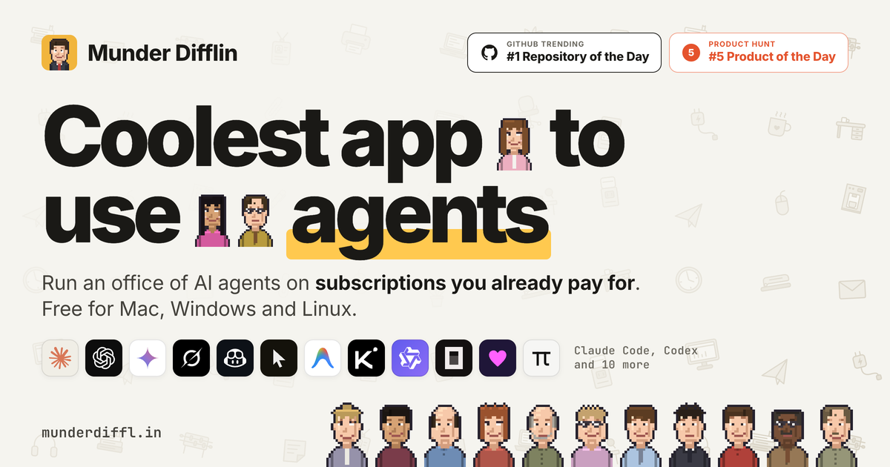
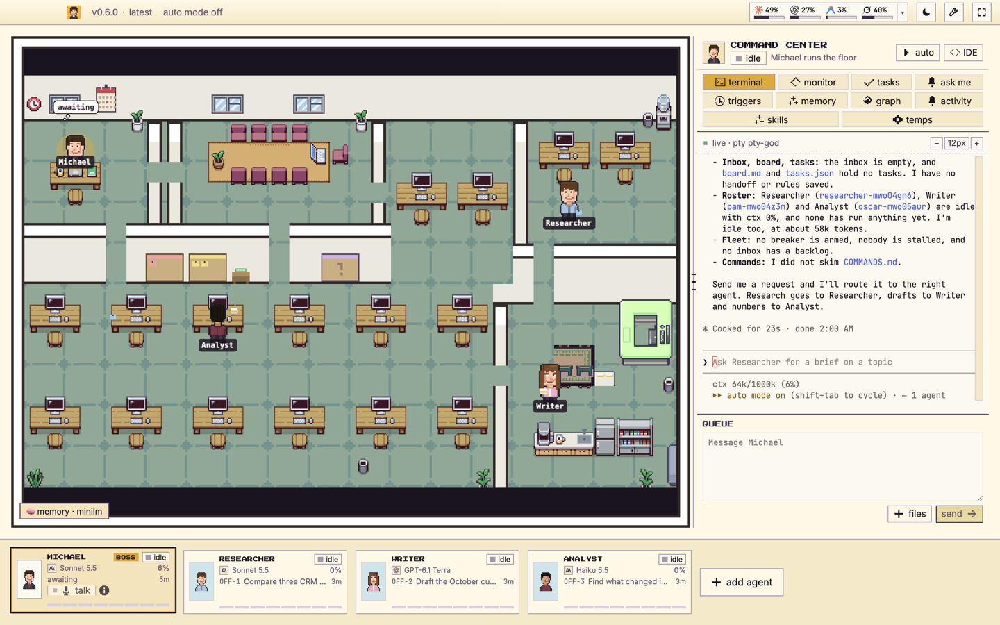
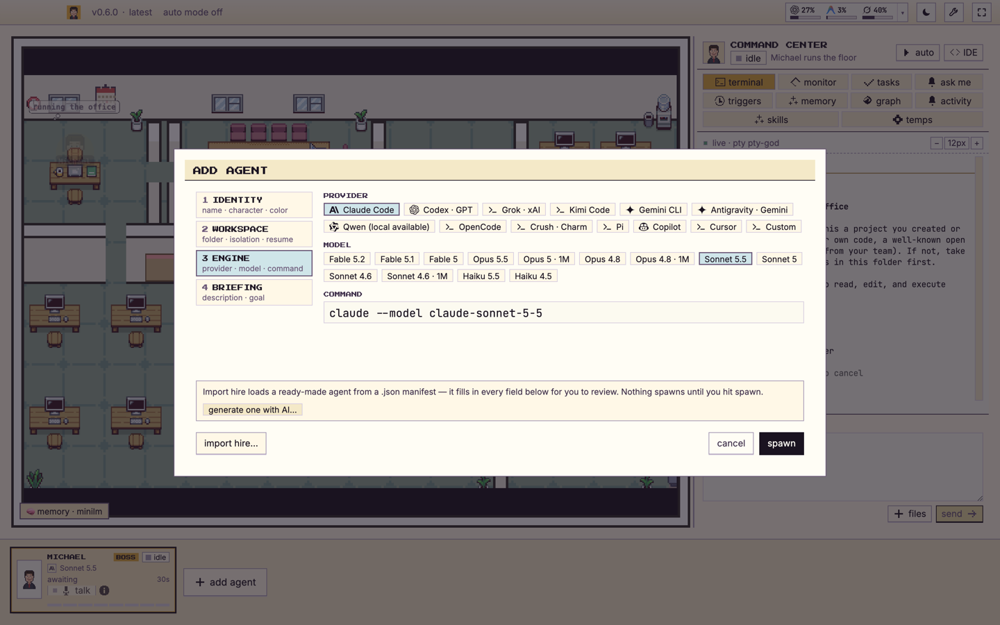
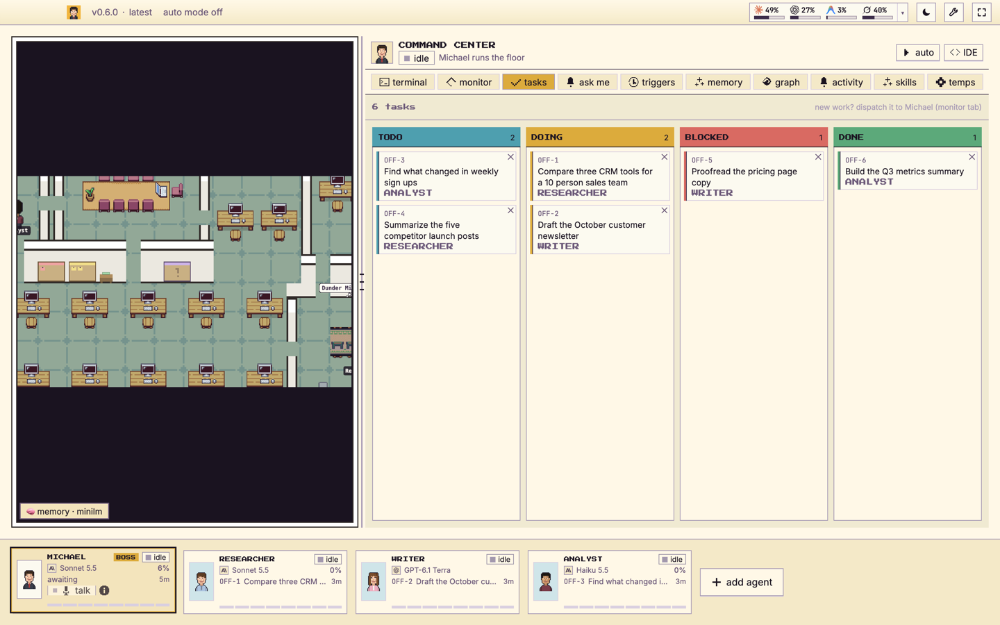
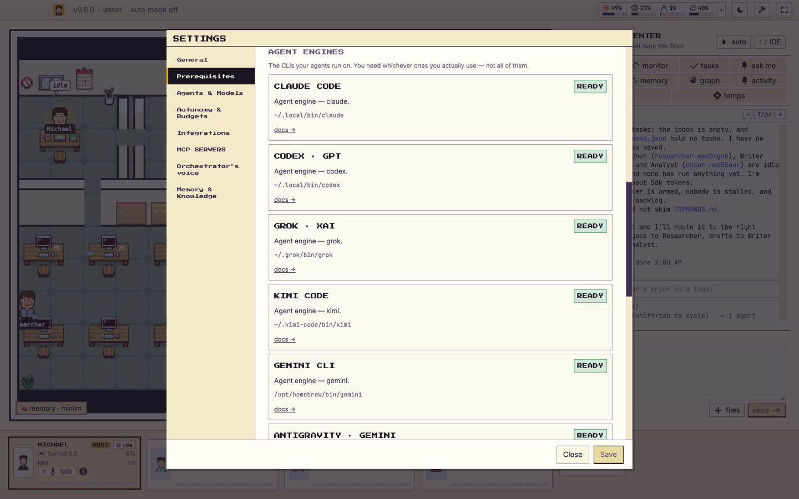

<div align="center">



# Munder Difflin

### Coolest app to use agents

Use the subscriptions you already pay for to run an office of AI agents on your own computer.<br>
Works with Claude, ChatGPT, Grok, Gemini and more. Free and open source.

<p>
  <a href="./LICENSE"></a>
  <a href="./CHANGELOG.md"></a>
  
  <a href="./CONTRIBUTING.md"></a>
  <a href="https://discord.gg/SEDzP5ZPk5"></a>
</p>

</div>



## What it is

Munder Difflin is a desktop app that runs a team of AI agents as an office you can watch. You hire
agents, give each one a role, a face and a model, and hand them work in plain words: research,
writing, analysis, planning, support, operations, and code too. They plan it, do it and report back.

- **Your subscriptions.** Each agent runs the real CLI you already use, signed in with your own plan.
  We do not sell model access.
- **Your computer.** Agents, memory and tasks are plain files in a folder you choose. Open them,
  back them up or delete them.
- **One person to talk to.** Michael, the orchestrator, takes your request and hands each piece to
  the right agent.

This repository is **Munder Difflin Classic**, MIT licensed. Releases ship as source code: you build
the app yourself (it takes a few minutes, see [Build from source](#build-from-source)).

## Engines

Twelve engines work side by side in one office, plus any command of your own. Each agent picks its
own, so one office can mix them.

<p>
  <a href="https://docs.claude.com/en/docs/claude-code"><kbd>Claude Code</kbd></a>
  <a href="https://github.com/openai/codex"><kbd>Codex</kbd></a>
  <a href="https://github.com/google-gemini/gemini-cli"><kbd>Gemini CLI</kbd></a>
  <a href="https://antigravity.google/docs/cli-overview"><kbd>Antigravity</kbd></a>
  <a href="https://x.ai/cli"><kbd>Grok</kbd></a>
  <a href="https://www.kimi.com/code"><kbd>Kimi Code</kbd></a>
  <a href="https://github.com/QwenLM/qwen-code"><kbd>Qwen</kbd></a>
  <a href="https://opencode.ai/docs"><kbd>OpenCode</kbd></a>
  <a href="https://github.com/charmbracelet/crush"><kbd>Crush</kbd></a>
  <a href="https://pi.dev/docs/latest"><kbd>Pi</kbd></a>
  <a href="https://docs.github.com/copilot/concepts/agents/about-copilot-cli"><kbd>GitHub Copilot</kbd></a>
  <a href="https://cursor.com/docs/cli/install"><kbd>Cursor</kbd></a>
  <kbd>+ any custom command</kbd>
</p>

API keys and local models (Ollama, LM Studio, vLLM) go in **Settings → Agents & Models**. A missing CLI
shows as a card in the agent's terminal: **Install** runs the installer, you sign in inside the app,
and the agent starts.

## How the office works

```
  you ──►  Michael (orchestrator)  ──► assigns · routes · asks you only when it matters
                    │
        ┌───────────┼───────────┐
        ▼           ▼           ▼
     agent A ◄──► agent B ◄──► agent C      each: a real CLI process + memory + mailbox
        └───────────┴───────────┘
   shared hive: memory · mailboxes · task board · event log   (plain files, local git)
```

1. **Every agent is a real terminal process** (`node-pty`, shown with xterm.js) with its own
   folder, memory and mailbox, and a character at a desk on the floor.
2. **Agents talk through the hive**, a local git repository of plain files. An agent writes to its
   `outbox/`, the app delivers to the recipient's `inbox/`, and only the app commits.
3. **Michael runs the floor.** He handles routine requests himself and puts anything that needs you
   (spend, deletions, a change of scope) in **Ask me**.
4. **Guard rails.** A circuit breaker watches every agent for loops, error storms and runaway spend,
   and you can set a token cap for each agent.

The full design is in [`HIVE.md`](./HIVE.md), [`SPEC.md`](./SPEC.md) and
[`docs/ARCHITECTURE.md`](./docs/ARCHITECTURE.md).

## What's in the box

| | |
|---|---|
|  |  |
| **Hire in a few clicks.** Name, role, engine and model, or start from a briefing template. | **Command Center.** The office's task board, next to Michael's terminal, Ask me, triggers, memory and skills. |
|  | |
| **Settings.** Prerequisites shows each engine and whether it is ready; keys, integrations and MCP servers sit beside it. | |

- **Memory.** Every agent keeps what it learns, and the whole office shares one memory you can search.
- **Schedules and webhooks.** Triggers start work on their own, on a schedule or when a service calls in.
- **Slack.** Send work from a thread and the answer comes back in the same thread.
- **Keys and integrations.** Save a key once in Settings and give it to the agents that need it.
- **MCP servers and skills.** Add tools to an agent from the catalog or by hand.
- **Files, editor and git.** Browse and edit each agent's folder, and see its history.

## Build from source

You need:

- macOS 12+, Windows 10/11 or a modern Linux desktop
- **Node 22** (Node 20 works too; Node 26 cannot run the native rebuild). `nvm use` reads `.nvmrc`.
- A C/C++ toolchain for `node-pty`: `xcode-select --install` on macOS, Build Tools on Windows
- At least one engine CLI from the list above, signed in

```bash
git clone https://github.com/HarnessMD/munder-difflin.git
cd munder-difflin
nvm use
npm install        # rebuilds node-pty for Electron
npm run dev        # starts the app
```

The first run walks you through setup, then you land on the floor with Michael at his desk.

To make an app you can keep: `npm run dist` (current OS), or `dist:mac`, `dist:win`, `dist:linux`.
The result is not signed, so macOS may ask you to right click it and choose **Open**, and Windows may
ask you to choose **More info**, then **Run anyway**. When a newer release is out, the app tells you;
pull the new tag and run the same steps.

Other scripts: `npm run typecheck`, `npm run build`, `npm run preview`.

## Contributing

Start with [`CONTRIBUTING.md`](./CONTRIBUTING.md). Keep `npm run typecheck` green and build new UI
from the tokens in [`DESIGN.md`](./DESIGN.md).

> [!IMPORTANT]
> **Every pull request shows a before and an after**: screenshots, or a recording when something
> moves, under `### Before` and `### After` in the PR template. A PR without them does not merge.
> See [Evidence is mandatory](./CONTRIBUTING.md#evidence-is-mandatory).

Small, self contained work is in
[`good first issue`](https://github.com/HarnessMD/munder-difflin/issues?q=is%3Aissue+is%3Aopen+label%3A%22good+first+issue%22).
Questions, bugs or your own office: [Discord](https://discord.gg/SEDzP5ZPk5). Everyone whose code is
in Munder Difflin is listed in [`CONTRIBUTORS.md`](./CONTRIBUTORS.md).

<a href="./CONTRIBUTORS.md">
  
</a>

## Telemetry

A build sends anonymous usage counts (app opened, agent added, feature used) only when it was built
with an analytics key. A build from this repository has no key and sends nothing. Never prompts,
files or agent output. Details in [`TELEMETRY.md`](./TELEMETRY.md).

## Munder Difflin Pro

A paid edition with more, which is not open source, is at [munderdiffl.in](https://munderdiffl.in).

## License

The **source code** is [MIT](./LICENSE). The bundled pixel art is **Modern Interiors - RPG Tileset
[16X16]** by [LimeZu](https://limezu.itch.io/moderninteriors), used under its Complete Version
licence, which **requires credit to LimeZu**; it is carved out of the MIT grant in
[`LICENSE-ASSETS`](./LICENSE-ASSETS). The Office cast is drawn in code (`portraitArt.ts`), not LimeZu
art. See [`ATTRIBUTION.md`](./src/renderer/src/assets/ATTRIBUTION.md).

*Munder Difflin* is a parody and is not affiliated with NBC's *The Office* or Dunder Mifflin.

## Acknowledgements

- [LimeZu](https://limezu.itch.io/) for the *Modern Interiors* tilesets.
- [`shahar061/the-office`](https://github.com/shahar061/the-office) for the office tileset and map vendoring.
- [Pixi.js](https://pixijs.com/), [xterm.js](https://xtermjs.org/), [node-pty](https://github.com/microsoft/node-pty), [electron-vite](https://electron-vite.org/) and [CodeMirror](https://codemirror.net/).
- *The Office* (US), for Munder Difflin, Inc.
